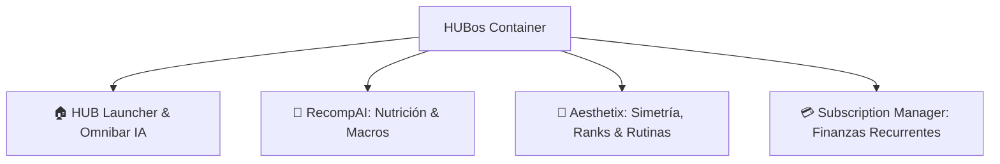

# 🚀 Proyecto: HUBos — Super-App Modular para iOS

> **Versión vigente publicada:** `v2.8.2` · [Release más reciente e IPA para SideStore/AltStore](https://github.com/Mofn23/HUBos/releases/latest). Las versiones `v2.8.1` y `v2.8.0` se conservan en el historial; cada build de iOS usa un tag único por ejecución.

> **Resumen Ejecutivo:** **HUBos** es un contenedor modular unificado y Super-App nativa para iOS (compatible con SideStore / AltStore). Permite ejecutar múltiples aplicaciones completas e independientes dentro de un solo archivo `.ipa`, **superando la restricción estricta de 3 aplicaciones activas de sideloading**.

---

## 📱 Módulos Integrados en el Ecosistema



### 1. 🏠 HUB Launcher
- **Dashboard Central:** Telemetría consolidada, accesos directos y conmutación de módulos en 0ms.
- **Omnibar de IA:** Barra de comandos en lenguaje natural para registrar comidas, suscripciones o entrenamientos en cualquier módulo mediante Gemini 2.0 Flash.

### 2. 🥗 RecompAI (Nutrición y Recomposición)
- **Escáner Nutricional por IA:** Desglose automático de calorías y macronutrientes a partir de fotos o texto.
- **Métricas:** Calorie Ring, Macro Bars, seguimiento de agua, suplementos, glucógeno y tendencia de peso.
- **Recomp Coach:** Entrenador conversacional alimentado con el contexto biométrico en tiempo real.

### 3. 💪 Aesthetix (Entrenamiento y Anatomía)
- **Modelo Anatómico y Heatmap:** Visualización de rangos musculares (Hierro, Bronce, Plata, Oro, Diamante, Campeón, Simétrico).
- **Tracker en Vivo:** Live Workout Fullscreen con series, repeticiones, RPE, descansos y cálculo de placas.
- **Importador de Simetría:** Auditoría de series y pesos desde capturas de pantalla de la app Symmetry.

### 4. 💳 Subscription Manager (Control de Gastos)
- **Control Financiero:** Historial de cargos recurrentes, cálculo de gasto mensual/anual y timeline de renovación.
- **Detección Inteligente:** Sugerencias de optimización y cancelación de servicios innecesarios.

> ℹ️ **Nota (2026-10-20):** el módulo *📅 Schedule* (horarios de clases) fue **retirado** del producto por decisión de uso. Las notificaciones nativas de suscripciones siguen activas en `src/lib/notifications.ts`.

---

## 🏗️ Especificaciones Técnicas y Repositorio

- **Repositorio Oficial de GitHub:** [github.com/Mofn23/HUBos](https://github.com/Mofn23/HUBos)
- **Branch Activa:** `main` (rama limpia y sincronizada con el remoto).
- **Diseño Visual:** Dark Mode OLED (`#131313`, `#1C1C1E`), acentos Verde iOS (`#34C759`) y Azul iOS (`#0A84FF`), micro-animaciones a 60fps con soporte para Dynamic Island.
- **Almacenamiento Local:** `@capacitor/preferences` con persistencia nativa offline-first.

---

## 🛠️ Comandos de Desarrollo y Compilación

Todos los comandos se ejecutan dentro del directorio del proyecto (`01_Projects/HUBos`):

```bash
# Iniciar servidor de desarrollo en local
npm run dev

# Compilar exportación estática de Next.js
npm run build

# Sincronizar cambios web con el contenedor nativo de iOS
npx cap sync ios

# Abrir proyecto en Xcode (si estás en macOS)
npx cap open ios

# Control de versiones Git (exclusivo para esta app)
git status
git add .
git commit -m "feat: nueva funcionalidad"
git push origin main
```

---

## 📑 Enlaces Rápidos a la Documentación del Proyecto
- 📖 [README.md Oficial](file:///E:/My%20Drive/Antigravity%20Obsidian/01_Projects/HUBos/README.md)
- 📝 [Historial de Versiones y Changelog (UPDATES.md)](file:///E:/My%20Drive/Antigravity%20Obsidian/01_Projects/HUBos/UPDATES.md)
- ⚙️ [Configuración de Capacitor](file:///E:/My%20Drive/Antigravity%20Obsidian/01_Projects/HUBos/capacitor.config.json)
- 📦 [Dependencias (package.json)](file:///E:/My%20Drive/Antigravity%20Obsidian/01_Projects/HUBos/package.json)

---

## 🔗 Conexiones en el Segundo Cerebro
- Área vinculada: [[02_Areas/Desarrollo_y_Tech]]
- MOC de referencia: [[00_Meta/MOCs/MOC_Desarrollo_Software]]
- Torre de Control Global: [[AI_ATLAS]]
- 🧭 Bitácora de la última entrega: [[00_Meta/Logs/2026-10-20_Correccion_Galeria_Calidad_Fotos_Gemini_HUBos_v2_8_2|v2.8.2 — Galería, fotos HD y Gemini]]
